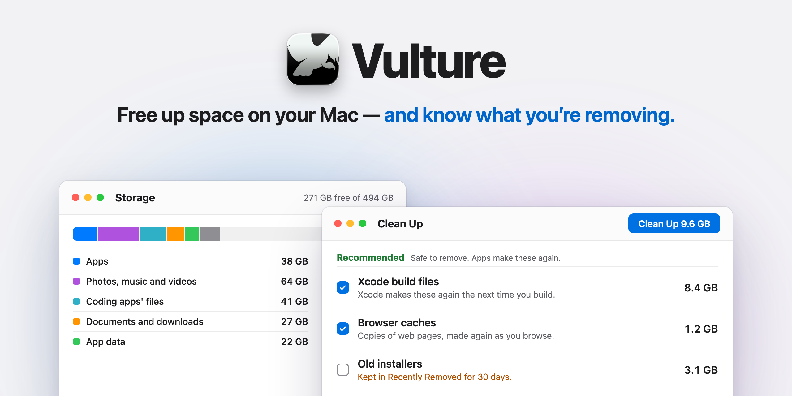

<p align="center">
  <picture>
    <source media="(prefers-color-scheme: dark)" srcset="Assets/banner-dark.png">
    
  </picture>
</p>

<p align="center">
  <a href="https://github.com/alsaadii98/vulture/releases/latest"><b>Download</b></a> ·
  <a href="#install">Install with Homebrew</a> ·
  <a href="#what-vulture-does">What it does</a> ·
  <a href="#is-it-safe">Is it safe?</a>
</p>

# Vulture

**Vulture shows you what's filling up your Mac, and helps you free up space without the worry.**

Every file it offers to remove comes with a plain explanation: what it is, which app made it, and whether that app will make it again. Your documents, photos and messages are never touched. Anything that can't come back by itself waits in Recently Removed for 30 days, so you can always change your mind.

Vulture is free, open source, and works on macOS 14 Sonoma or later, on both Apple silicon and Intel Macs.

## What Vulture does

| | |
|---|---|
| **Clean Up** | Finds caches, logs, leftover installers and other clutter. Each item says what it is and why it's safe to remove. You choose what goes. |
| **Storage** | Shows what kinds of things use your disk (apps, photos, coding files, system data) and what changed this week. |
| **Apps** | Lists your apps, largest first, with when you last used each one. Removes an app together with the files it leaves behind, and can undo that. |
| **Startup** | Shows what starts by itself when you log in, and lets you turn things off without deleting them. |
| **Developer Files** | For people who write code: old project build folders, simulators, Docker leftovers and Time Machine copies. Only shown when coding apps are found. |
| **Recently Removed** | Everything that can't be made again is kept here for 30 days. Put it back exactly where it was with one click. |
| **Menu bar monitor** | Optional. A small view of memory, disk and processor use in the menu bar. Off until you turn it on. |

## Is it safe?

- **Every file is explained.** Nothing is removed because "a scan said so". Each kind of file is described by a rule written in plain words, and you can read all of them in [`Sources/VultureCore/Rules`](Sources/VultureCore/Rules).
- **Some places are never touched.** Documents, Desktop, Photos, Messages, Mail, iCloud Drive, keychains, SSH keys and AI assistants' chats are off limits. No rule can change that.
- **You can undo.** Files apps make again on their own (like caches) are removed right away, so you get the space now. Anything that can't come back by itself (installers, old downloads, archives) goes to Recently Removed for 30 days first.
- **Open apps are left alone.** If an app is running, or any app has a file open, Vulture skips it.
- **It checks again right before acting.** Just before removing anything, Vulture makes sure it's still the same item and that nothing protected is involved.
- **Honest about caches that come back.** If a folder fills up again within two days of cleaning, Vulture stops recommending it and tells you why.
- **Open source.** All of the code is public under the GPL-3.0 license, so anyone can check what it does.

## Install

### With Homebrew (recommended)

If you use [Homebrew](https://brew.sh), run:

```bash
brew install --cask alsaadii98/vulture/vulture
```

This installs Vulture in your Applications folder and also installs the `vulture` command for Terminal.

> **Why Homebrew is easier:** you get the `vulture` command too, and `brew` keeps track of the install for you. Vulture isn't notarized by Apple yet, so whichever way you install it, macOS asks you to confirm the first time you open it. See [the first time you open it](#the-first-time-you-open-it) below. After that, updates don't ask again.

### Download

1. Go to the [latest release](https://github.com/alsaadii98/vulture/releases/latest).
2. Download `Vulture-VERSION.dmg` (or the `.zip`).
3. Drag **Vulture** into your **Applications** folder.

### The first time you open it

macOS will say it can't check Vulture for malicious software. That's because Vulture isn't notarized yet, not because something is wrong. To open it:

1. Try to open Vulture once, then click **Done**.
2. Open **System Settings → Privacy & Security**.
3. Scroll down and click **Open Anyway** next to the message about Vulture.

Or, in Terminal:

```bash
xattr -dr com.apple.quarantine /Applications/Vulture.app
```

Each release lists checksums in a `SHA256SUMS` file, so you can confirm your download is the real one.

## Updates

You don't need to reinstall Vulture to get new versions.

- **Vulture checks for updates once a day.** It only downloads a small file from github.com and sends nothing about you or your Mac.
- **It asks before installing.** When a new version is ready, click **Install and Relaunch**. You can also choose **Vulture → Check for Updates…** at any time, or turn automatic checks off in Settings.
- **Every update is verified.** An update is only installed if it's signed with the same Vulture release key as the copy you already have. Anything else is refused.
- **Your permissions stay.** Full Disk Access stays granted after an update.
- **In Terminal:** `vulture update` installs the newest version, and `vulture update --check` only checks.
- **Homebrew users:** the app updates itself. `brew upgrade --cask --greedy vulture` works too.

### Uninstall

```bash
brew uninstall --cask vulture
```

Add `--zap` to also remove Vulture's settings and history. If you downloaded it, drag Vulture from Applications to the Trash.

## Permissions

Vulture works without any special permissions. For complete results, you can give it **Full Disk Access** in **System Settings → Privacy & Security → Full Disk Access**.

Without it, Vulture skips folders where other apps keep private data instead of setting off a stream of permission prompts. Your Storage numbers will then show some space as "couldn't be read". Vulture never sends any of your files or file names anywhere.

## Command-line tool

The `vulture` command does everything the app does, from Terminal. It's installed with Homebrew, and lives inside the app at `Vulture.app/Contents/Helpers/vulture`.

| Command | What it does |
|---|---|
| `vulture scan` | What could be cleaned, and why |
| `vulture clean` | Clean up the recommended items (asks first) |
| `vulture removed` | What's in Recently Removed |
| `vulture restore ID` | Put a clean-up back |
| `vulture storage` | What kinds of things use your disk |
| `vulture history` | What changed on your disk this week |
| `vulture size ~` | What's using space in a folder |
| `vulture apps` | Apps, largest first, with when each was last used |
| `vulture uninstall Figma` | Remove an app and what it keeps (undoable) |
| `vulture leftovers` | Files left by apps that are already gone |
| `vulture startup` | What starts by itself |
| `vulture dev` | Simulators, Docker and old projects |
| `vulture projects` | Build folders in projects untouched for 90 days |
| `vulture update` | Install the newest version |
| `vulture scan --json` | The same results, for scripts and AI agents |

To check other folders with the command-line tool, give **Terminal** Full Disk Access too.

## For developers

### Build from source

You need macOS 14 or later and Xcode 16 or later.

```bash
git clone https://github.com/alsaadii98/vulture.git
cd vulture
scripts/make-app.sh && open build/Vulture.app
```

`swift build -c release` builds just the command-line tool, at `.build/release/vulture`. Run the tests with `swift test`.

### Project layout

| Path | What's there |
|---|---|
| `Sources/VultureCore` | The engine: scanner, rules, safety checks, clean-up planner. No user interface. |
| `Sources/VultureCore/Rules` | The cleaning rules, as JSON. See [docs/rules.md](docs/rules.md). |
| `Sources/VultureApp` | The Mac app (SwiftUI) |
| `Sources/vulture` | The command-line tool |
| `Tests/VultureCoreTests` | Tests that build throwaway folders; they never touch your real files |
| `scripts/` | `make-app.sh` builds the app; `release.sh VERSION` builds a release |

### Contributing

Vulture is written from scratch. Please don't copy code, comments, tests or file lists from other cleaners, open source or not. Describe what a folder is from the app's own documentation or your own testing.

New files start with:

```swift
// Vulture — a free, open-source cleaner and disk tool for macOS.
// Copyright (C) 2026 Vulture contributors
// SPDX-License-Identifier: GPL-3.0-or-later
```

Run `swift test` and `vulture check-rules Sources/VultureCore/Rules` before sending a change.

## License

Vulture is free software under the GPL-3.0-or-later license. See [LICENSE](LICENSE).

The Vulture name and logo are covered by [TRADEMARK.md](TRADEMARK.md): forks are welcome, but must use their own name.

Vulture is an independent project. It isn't affiliated with Apple or with any other cleaning app, including Mole.
